<div align="center">

<picture>
  <source media="(prefers-color-scheme: dark)" srcset="docs/images/banner-en-dark.svg">
  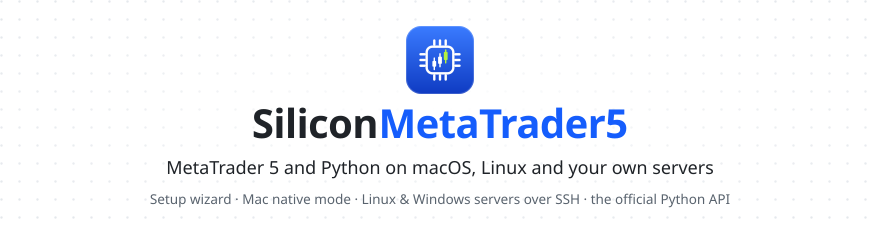
</picture>

<p>
  <a href="#install"><b>Install</b></a> &nbsp;·&nbsp;
  <a href="#a-tour-of-the-app"><b>Tour</b></a> &nbsp;·&nbsp;
  <a href="#python-quick-start"><b>Python</b></a> &nbsp;·&nbsp;
  <a href="#smt5-command-line"><b>CLI</b></a> &nbsp;·&nbsp;
  <a href="README_TR.md"><b>Türkçe</b></a>
</p>

<a href="https://github.com/bahadirumutiscimen/silicon-metatrader5/releases/latest"></a>
<a href="https://pypi.org/project/siliconmetatrader5/"></a>
<a href="https://github.com/bahadirumutiscimen/silicon-metatrader5/blob/stats/README.md"></a>
<a href="https://pepy.tech/projects/siliconmetatrader5"></a>
<a href="https://pypistats.org/packages/siliconmetatrader5"></a>


<a href="#license"></a>

<br><br>

<picture>
  <source media="(prefers-color-scheme: dark)" srcset="docs/images/en/overview-dark.webp">
  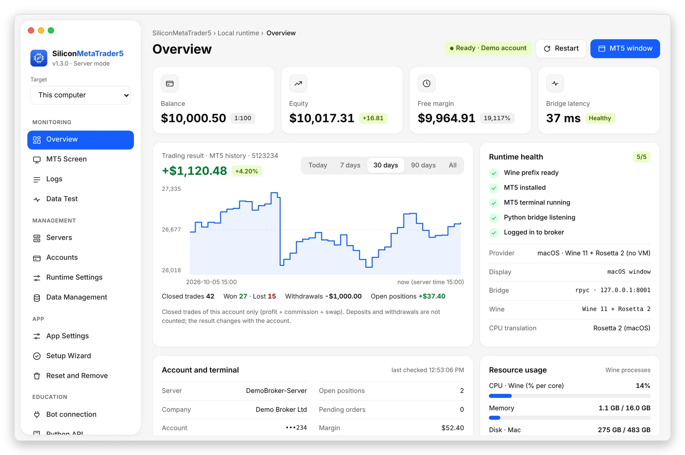
</picture>

**Overview.** Balance, equity, trading result and runtime health in one place.

</div>

SiliconMetaTrader5 runs a real **MetaTrader 5** terminal next to a small Python bridge, so code written for MetaQuotes' official [`MetaTrader5`](https://www.mql5.com/en/docs/python_metatrader5) package works on a **Mac**, on **Linux**, or on a **Linux or Windows server** you own. Your code changes only one line.

> [!CAUTION]
> Test your strategy on a demo account before trading real money.

## At a glance

| | SiliconMetaTrader5 |
| :-- | :-- |
| **What it is** | A desktop app, a runtime and a Python package that run MetaTrader 5 (MT5) for Python code outside Windows |
| **Python API** | Same functions as MetaQuotes' official `MetaTrader5` package: `copy_rates_from_pos`, `symbol_info_tick`, `order_send`, `positions_get`, … |
| **Runs on** | macOS on Apple Silicon (M1, M2, M3, M4) and Intel · Linux x86_64 · your own Linux or Windows VPS over SSH |
| **For** | Algorithmic trading, trading bots, backtests, research notebooks and data pipelines that use MT5 market data and orders |
| **Install** | `brew tap bahadirumutiscimen/siliconmt5 https://github.com/bahadirumutiscimen/silicon-metatrader5 && brew trust bahadirumutiscimen/siliconmt5 && brew install siliconmt5` · `.deb` / `.AppImage` · `pip install siliconmetatrader5` |

## Highlights

<table>
<tr>
<td width="33%" valign="top"><br><b>Setup wizard</b><br>Checks the machine, installs what is missing with your approval and tests that real data arrives.</td>
<td width="33%" valign="top"><br><b>Mac native mode</b><br>MT5 in Wine 11 under Rosetta 2. No VM, no Docker: up to 30× faster than v1.2.</td>
<td width="33%" valign="top"><br><b>Your own servers</b><br>Linux or Windows VPS over SSH. Keeps trading while your computer is off.</td>
</tr>
<tr>
<td valign="top"><br><b>MT5 screen in the app</b><br>Log in to your broker and use charts. ⌘C / ⌘V reach MT5 as Ctrl, the clipboard syncs.</td>
<td valign="top"><br><b>Bot connection guide</b><br>Shows the exact host and port for wherever your bot runs, with a 3-line test.</td>
<td valign="top"><br><b>Data and speed tests</b><br>Bars, ticks and the broker's clock checked through the same path your code uses.</td>
</tr>
<tr>
<td valign="top"><br><b>Data management</b><br>History and tick storage per broker, symbol and year, with safe cleanup.</td>
<td valign="top"><br><b><code>smt5</code> command line</b><br>Everything the app does, from a terminal or a script. Every command has <code>--json</code>.</td>
<td valign="top"><br><b>Private by design</b><br>Ports listen on 127.0.0.1 only. The app never reads or stores your passwords.</td>
</tr>
</table>

## Faster in 1.3

The new **Mac native mode** runs MT5 directly on macOS, without a virtual machine. Same Mac, v1.2 vs v1.3:

<p align="center">
<picture>
  <source media="(prefers-color-scheme: dark)" srcset="docs/images/speed-en-dark.svg">
  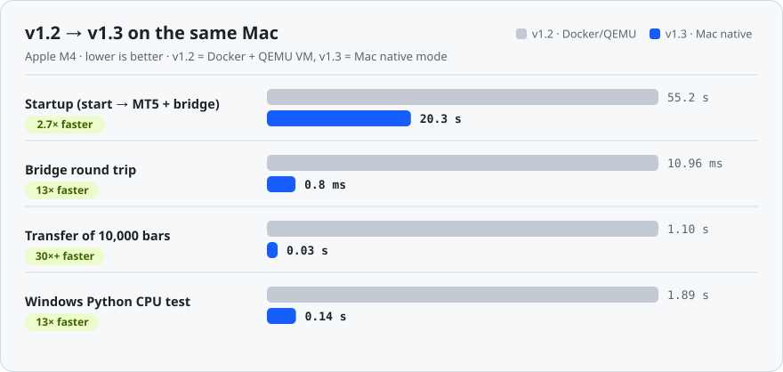
</picture>
</p>

Run the same test on your machine from the **Data Test** page or with `smt5 bench`.

## How it fits together

<p align="center">
<picture>
  <source media="(prefers-color-scheme: dark)" srcset="docs/images/arch-en-dark.svg">
  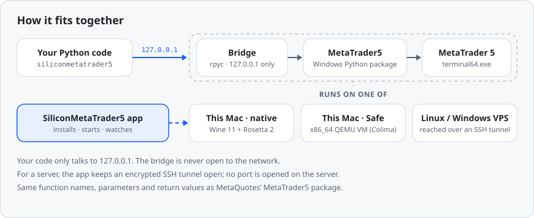
</picture>
</p>

### Where MT5 can run

| | Mode | How MT5 runs | Good for |
| :-- | :-- | :-- | :-- |
|  **macOS** | **Mac native** (recommended) | Directly on macOS, as a normal window | Development, backtests, bots while the Mac is on |
|  **macOS** | **Safe** (fallback) | In an isolated virtual machine | Macs without Rosetta 2 |
|  **Linux x86_64** | **Linux native** or **Docker** | Directly, with or without a display | Linux desktops and PCs |
|  **Linux server** | Linux native or Docker | Installed and managed by the app over SSH | 24/7 bots |
|  **Windows server** | Windows | Natively, managed by the app over SSH | 24/7 bots |

### Other ways to use MT5 from Python outside Windows

| | Windows virtual machine | Wine set up by hand | **SiliconMetaTrader5** |
| :-- | :-- | :-- | :-- |
| Setup | Install Windows, MT5 and Python inside the VM | Install Wine, Windows Python, MT5 and a bridge yourself | One wizard, every step checked |
| Your Python code | Runs inside the VM, or needs its own network bridge | Needs a bridge you maintain | Runs on your machine; one line points it at 127.0.0.1 |
| Apple Silicon | Windows on ARM runs MT5 under its own emulation | Depends on the Wine build | Wine 11 + Rosetta 2, measured above |
| Servers | Separate setup per VPS | Separate setup per VPS | Linux and Windows VPS from the same app, over SSH |
| Monitoring | None built in | None built in | Health, logs, data and speed tests, menu bar panel |

## Install

**macOS**

```bash
brew tap bahadirumutiscimen/siliconmt5 https://github.com/bahadirumutiscimen/silicon-metatrader5
brew trust bahadirumutiscimen/siliconmt5
brew install siliconmt5
smt5 app-install          # adds the app to Applications
```

**Linux x86_64**: the `.deb` or `.AppImage` from [Releases](https://github.com/bahadirumutiscimen/silicon-metatrader5/releases/latest).

**Python**

```bash
pip install siliconmetatrader5
```

<details>
<summary><b>Build from source</b></summary>

```bash
git clone https://github.com/bahadirumutiscimen/silicon-metatrader5.git
cd silicon-metatrader5/app
cargo build --release -p smt5-cli -p smt5-desktop   # app: target/release/siliconmt5 · CLI: target/release/smt5
export PATH="$PWD/target/release:$PATH"
```

See [`app/README.md`](app/README.md) for Linux build dependencies.
</details>

## A tour of the app

### Setup wizard

<p align="center">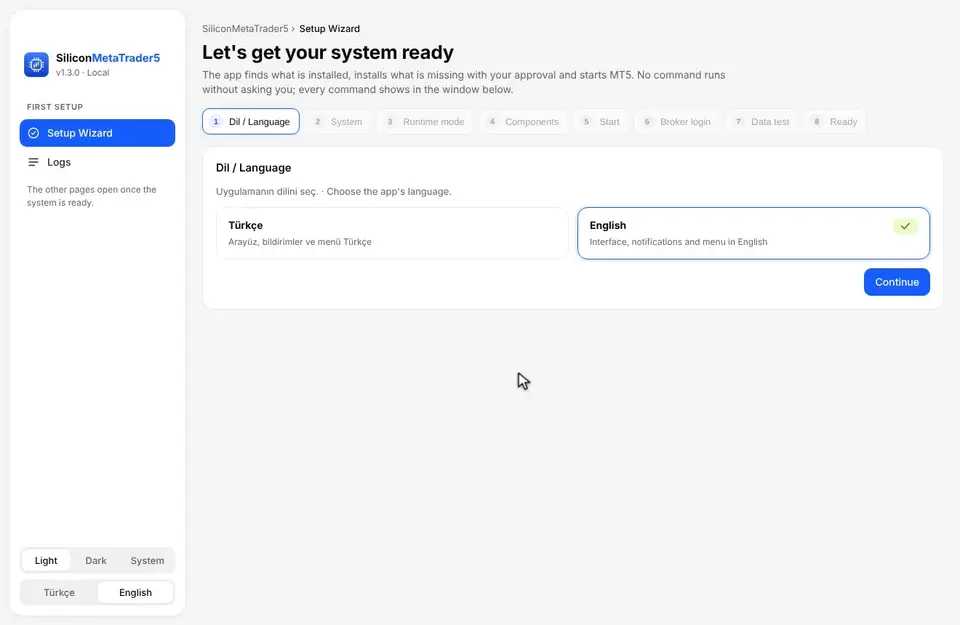</p>

**From an empty Mac to a running MT5.** Choose the language, system and mode. The wizard installs what is missing with your approval, starts MT5 and checks the data.

### MT5 screen

<table>
<tr>
<td width="50%" valign="top">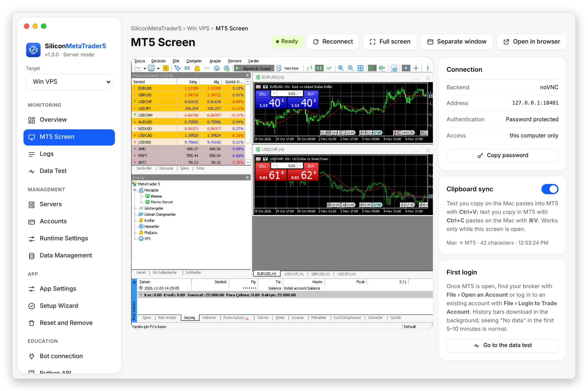</td>
<td width="50%" valign="top">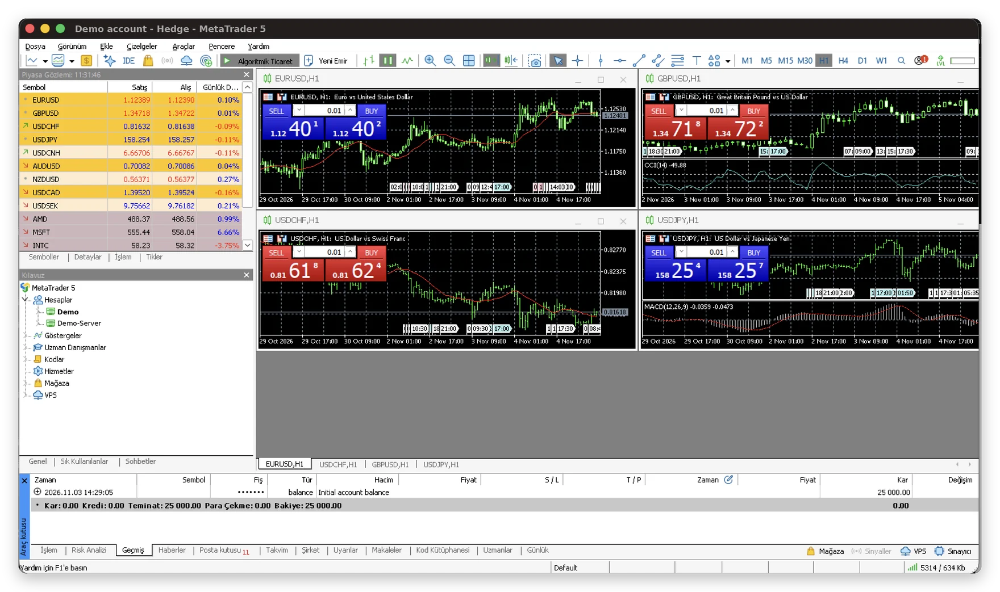</td>
</tr>
<tr>
<td valign="top"><b>Inside the app</b> for servers and Linux. ⌘C / ⌘V work as in any Mac app and the clipboard syncs both ways.</td>
<td valign="top"><b>A normal macOS window</b> in the Mac native mode.</td>
</tr>
</table>

### Servers

<p align="center">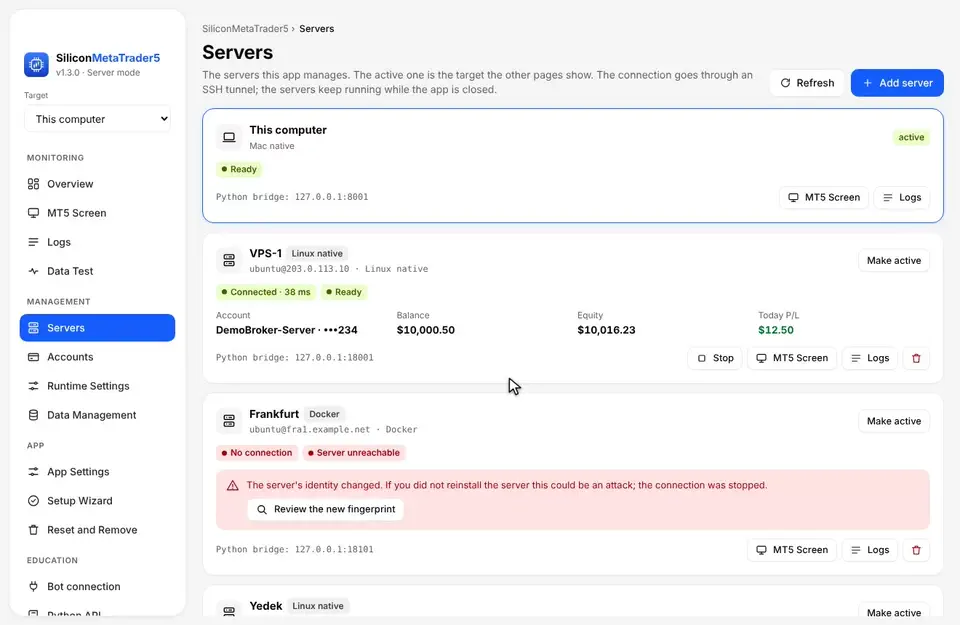</p>

**Add a server in one form.** Choose Linux or Windows and enter the SSH address. The precheck shows what is missing and how to fix it.

<p align="center">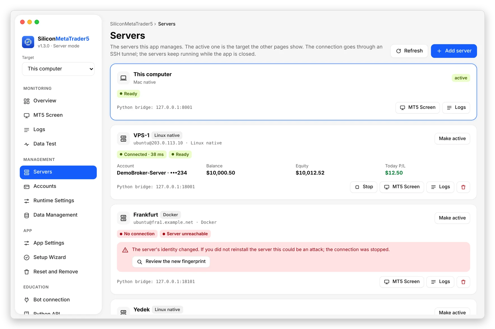</p>

**Every server is a card** with its connection, account, balance and today's result. Servers keep running while the app is closed.

<details>
<summary><b>Linux server requirements</b></summary>

* Ubuntu or Debian, x86_64, 2 GB RAM, 3 GB free disk.
* Missing packages are listed by the precheck with the command to install them.
</details>

<details>
<summary><b>Windows server requirements</b></summary>

* Windows 10 1809+ or Windows Server 2019+, x64, an administrator account.
* OpenSSH Server turned on once; the wizard shows the command.
* MT5 needs a signed-in desktop, so setup turns on automatic sign-in and restarts once. You type the password on the server; the app never sees it.
* Uninstall removes only what the app installed.
</details>

### Bot connection

<p align="center">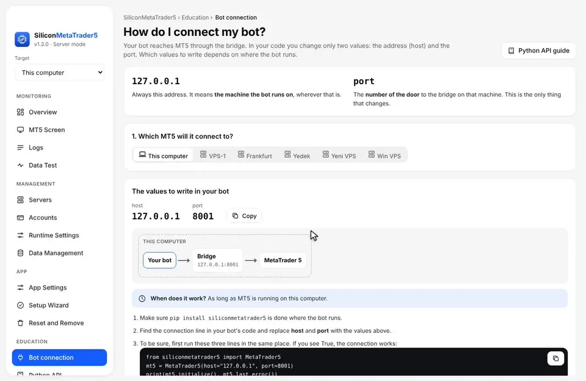</p>

**Which address does my bot use?** Pick the MT5 and where the bot runs; the page shows the host and port for your setup.

| Your bot runs | Host | Port | Works |
| :-- | :-- | :-- | :-- |
| On this computer, MT5 on this computer | `127.0.0.1` | the local bridge port (8001) | while MT5 runs |
| On this computer, MT5 on a server | `127.0.0.1` | the server's tunnel port (e.g. 18001) | while the app is open |
| On the server itself | `127.0.0.1` | the server's own bridge port (8001) | always, even with your computer off |
| On another computer | `127.0.0.1` | after `ssh -N -L 18001:127.0.0.1:8001 user@server` | while that command runs |

The bridge listens only on 127.0.0.1, so use these values instead of the server's IP.

### Data test and speed test

<p align="center">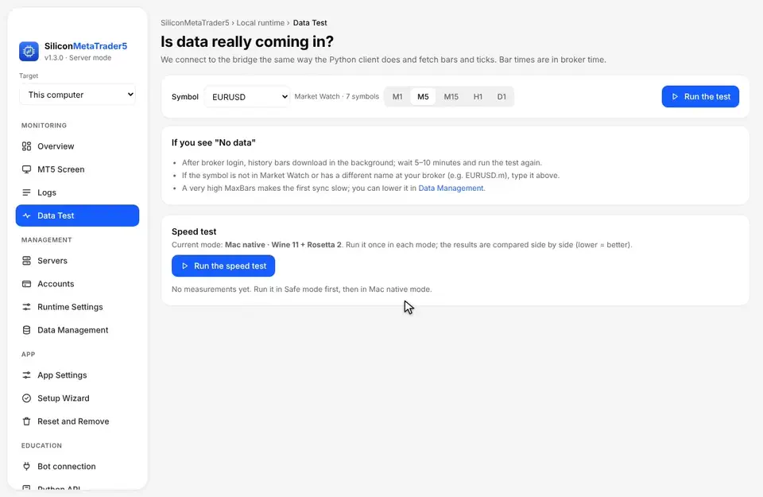</p>

**Is data really coming in?** Eight checks through the same bridge your code uses, with the last bars drawn. The speed test compares the modes.

### Data, accounts and logs

<table>
<tr>
<td width="50%" valign="top">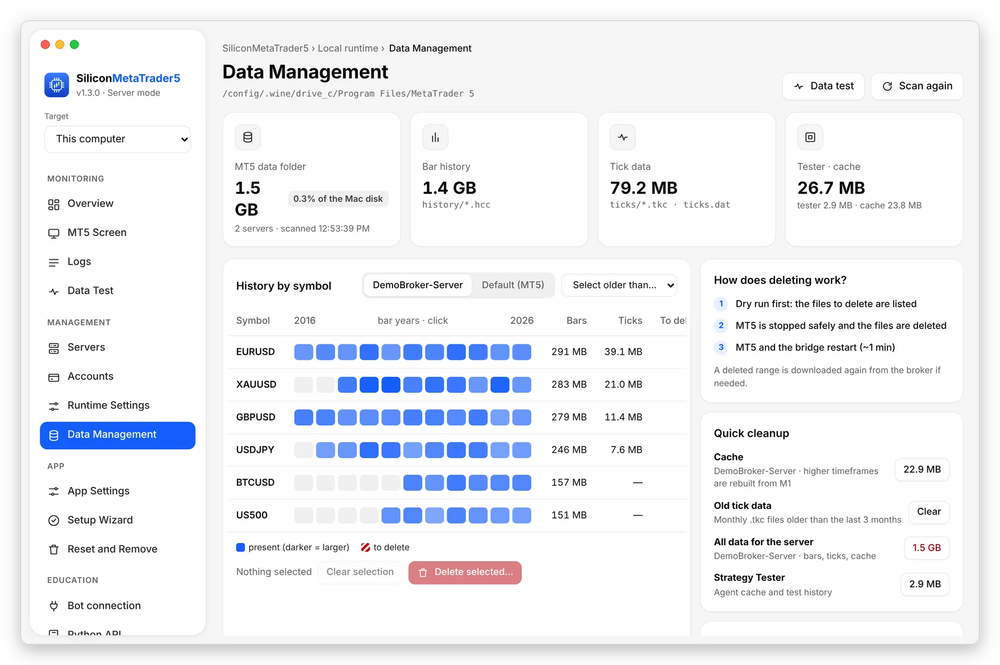<br><b>Data management.</b> History and ticks per broker, symbol and year, with safe cleanup.</td>
<td width="50%" valign="top">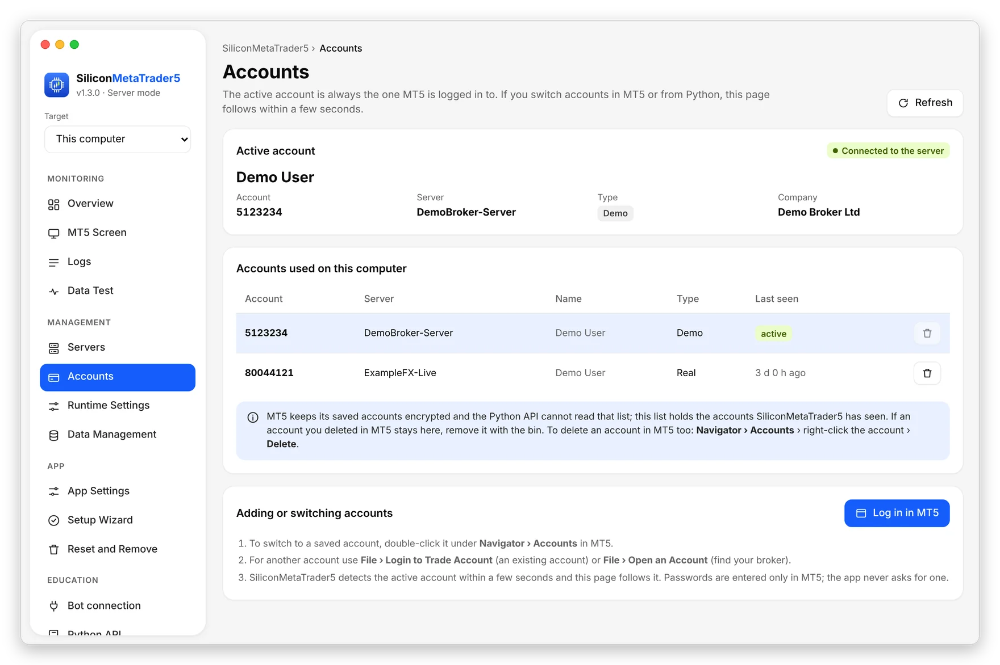<br><b>Accounts.</b> The active account and the accounts used on this computer.</td>
</tr>
<tr>
<td valign="top">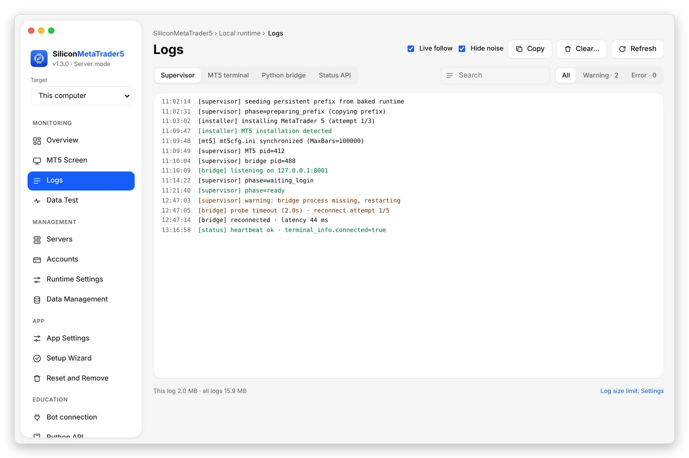<br><b>Logs.</b> Live logs with search and a noise filter.</td>
<td valign="top">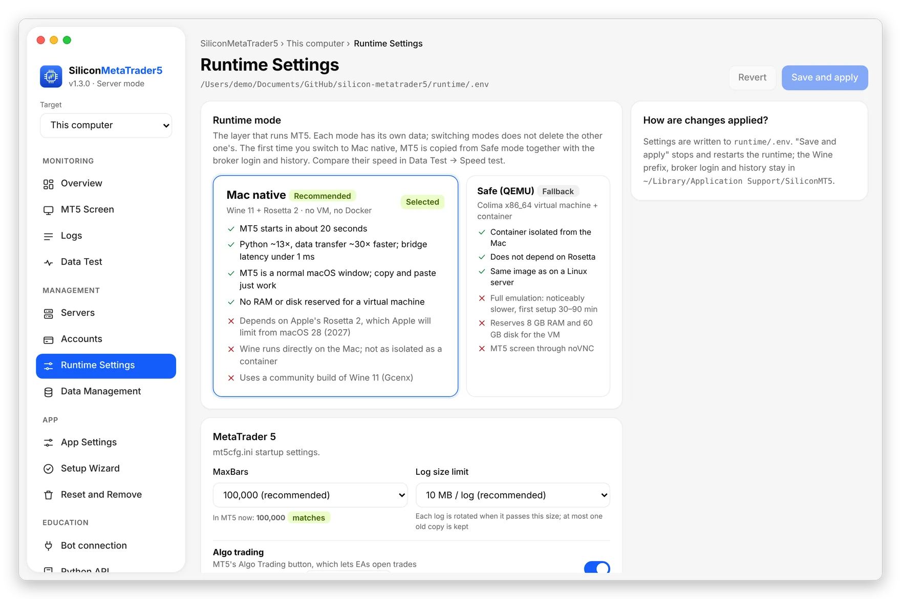<br><b>Runtime settings.</b> Mode, MaxBars, Algo Trading, screen and ports.</td>
</tr>
<tr>
<td valign="top">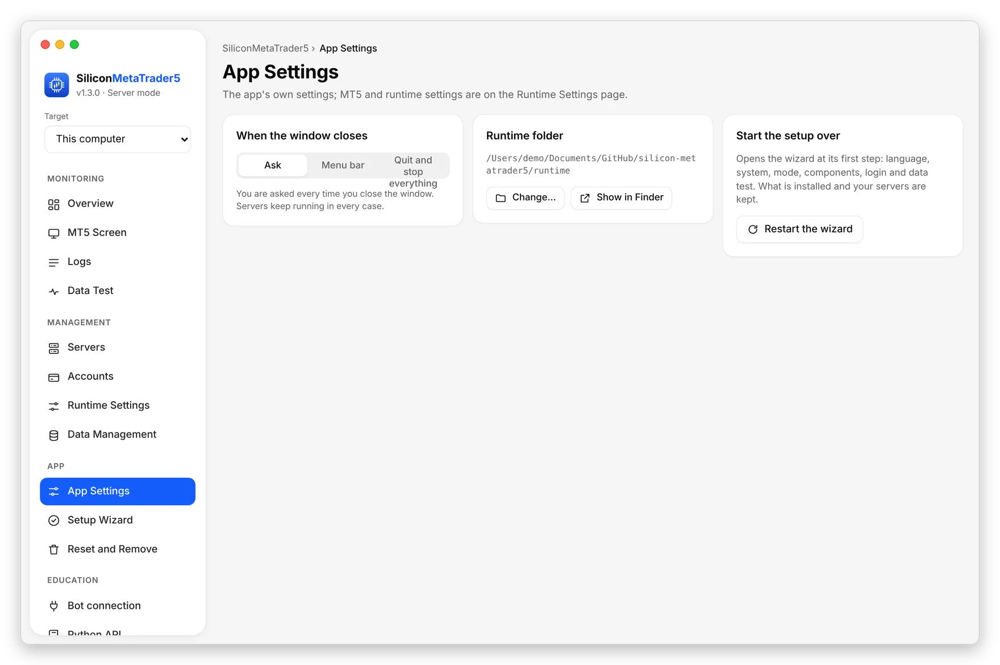<br><b>App settings.</b> Window behaviour and setup.</td>
<td valign="top">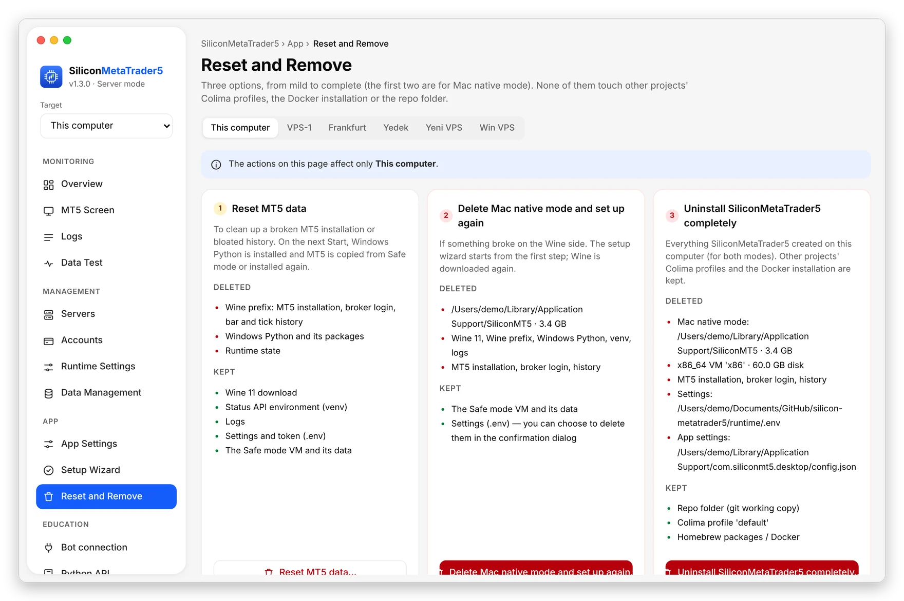<br><b>Reset and remove.</b> Reset MT5 data or remove everything, with a clear list of what is deleted.</td>
</tr>
</table>

### Menu bar, Python guide and an example strategy

<table>
<tr>
<td width="28%" valign="top">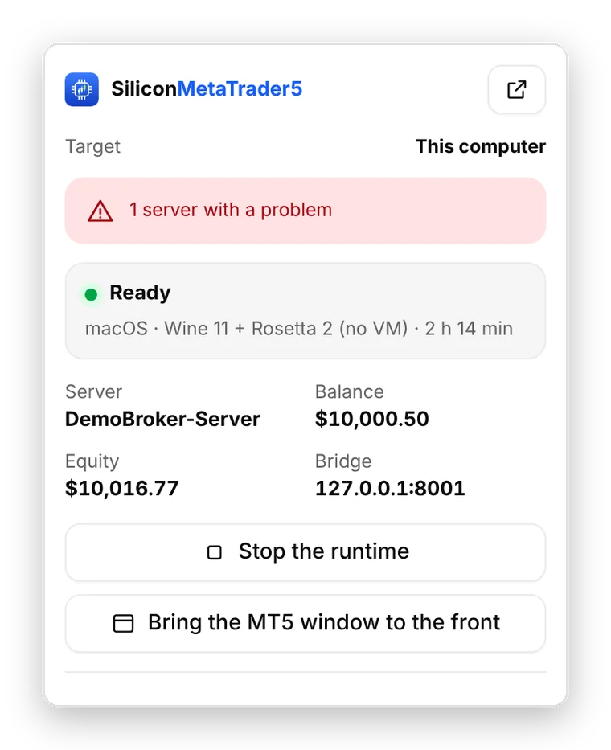<br><b>Menu bar panel.</b> Status and balance at a glance.</td>
<td width="36%" valign="top">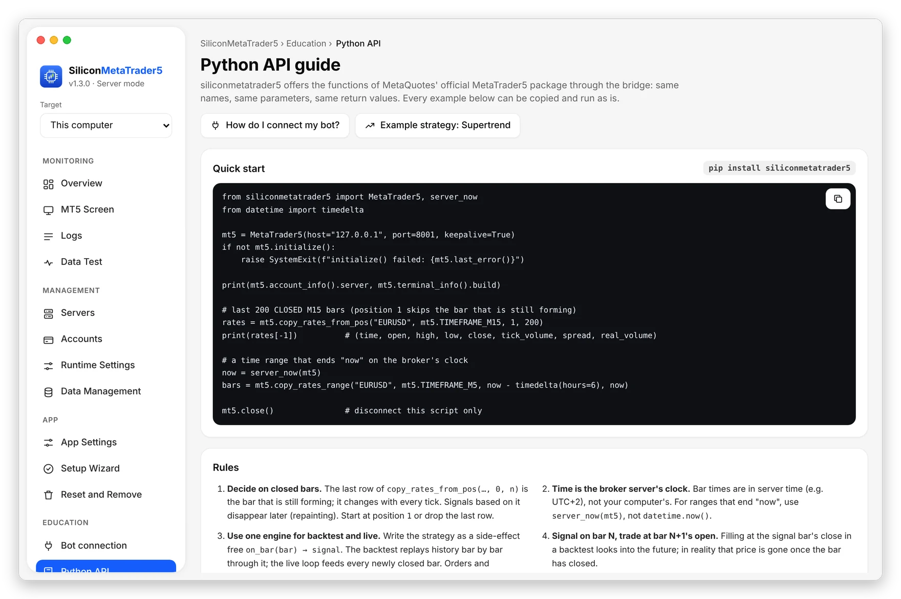<br><b>Python API guide.</b> Every function with a copyable example.</td>
<td width="36%" valign="top">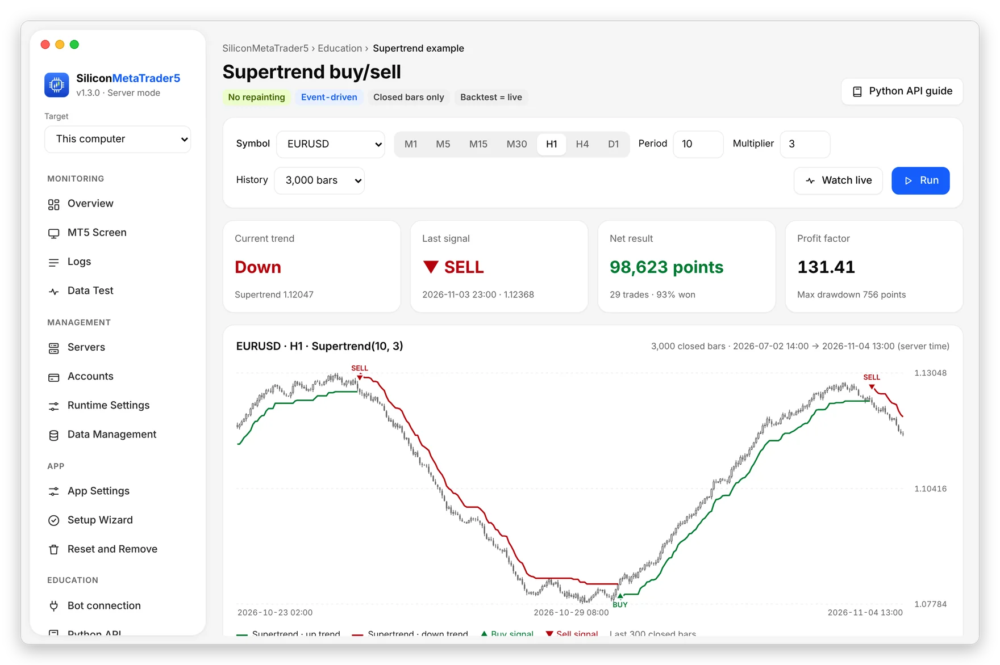<br><b>Supertrend example.</b> Same code for backtest and live signals.</td>
</tr>
</table>

## Python quick start

After logging in to your broker in MT5:

```python
import pandas as pd
from datetime import timedelta
from siliconmetatrader5 import MetaTrader5, server_now

mt5 = MetaTrader5(host="127.0.0.1", port=8001, keepalive=True)   # see "Bot connection" for the port
if not mt5.initialize():
    raise SystemExit(f"initialize() failed: {mt5.last_error()}")

print(mt5.account_info().server, mt5.terminal_info().build)

# last 200 closed M15 bars (position 1 skips the bar that is still forming)
rates = mt5.copy_rates_from_pos("EURUSD", mt5.TIMEFRAME_M15, 1, 200)
print(pd.DataFrame(rates).tail())

# a range that ends "now" on the broker's clock
now = server_now(mt5)
bars = mt5.copy_rates_range("EURUSD", mt5.TIMEFRAME_M5, now - timedelta(hours=6), now)

mt5.close()   # disconnects this script only; shutdown() would disconnect every client of the bridge
```

Moving a bot from the official package changes only the connection lines:

```python
# before                               # after
import MetaTrader5 as mt5              from siliconmetatrader5 import MetaTrader5
mt5.initialize()                       mt5 = MetaTrader5(host="127.0.0.1", port=8001)
                                       mt5.initialize()
```

Bar times are on the broker's clock; use `server_now(mt5)` instead of `datetime.now()`. More in the [client README](client/README.md).

## `smt5` command line

<details>
<summary><b>Command reference</b></summary>

| Command | What it does |
| :-- | :-- |
| `smt5 doctor` | Checks prerequisites and health, with the exact fix for each problem |
| `smt5 init` | Creates the settings with a random API token |
| `smt5 mode [safe\|native]` | Shows or switches the mode (the running one is stopped first) |
| `smt5 build` / `pull` | Installs the native runtime, or builds / pulls the Docker image |
| `smt5 up` / `down` / `restart [mt5\|bridge]` | Start, stop, restart |
| `smt5 status` / `watch` / `logs <source>` | Phase, live phase, logs |
| `smt5 test EURUSD --tf M5` | Data test through the bridge |
| `smt5 bench` | Speed test: startup, CPU, copy_rates, transfer, latency |
| `smt5 symbols` | Market Watch symbols |
| `smt5 data` / `purge …` | History inventory and safe deletion |
| `smt5 mt5-import` | Copies MT5 (login and history) from the Safe mode into the native mode |
| `smt5 vm start\|stop\|status` | The Safe mode's Colima VM |
| `smt5 app-install` | macOS Homebrew: copies the app into Applications |

All commands accept `--json`.
</details>

## Security and privacy

* Every port listens on 127.0.0.1; servers are reached through an encrypted SSH tunnel.
* The app never reads or stores your passwords.
* A server whose identity changes is blocked until you approve it.

## FAQ

<details><summary><b>How do I use the MetaTrader5 Python package on a Mac with Apple Silicon (M1, M2, M3, M4)?</b></summary>

Install SiliconMetaTrader5 and `pip install siliconmetatrader5`, then replace `import MetaTrader5 as mt5` with `mt5 = MetaTrader5(host="127.0.0.1", port=8001)`. The rest of your code stays the same.
</details>

<details><summary><b>Does the MetaTrader 5 Python API work on Linux?</b></summary>

Yes, on Linux x86_64, with or without a display.
</details>

<details><summary><b>How do I run an MT5 trading bot 24/7 on a VPS?</b></summary>

Add the server in the app, copy your bot to it and connect to `127.0.0.1:8001` there. It keeps running while your computer is off.
</details>

<details><summary><b>Can I place orders, or is it read-only?</b></summary>

Everything the official package can do works, including `order_send` and `positions_get`.
</details>

<details><summary><b>I restarted my Mac. What now?</b></summary>

Open the app and press **Start**. Servers keep running on their own.
</details>

<details><summary><b>Can I keep using MT5 data from v1.2 (Safe mode)?</b></summary>

Yes. The Mac native mode copies your login and history from it.
</details>

<details><summary><b>The data test says "No data".</b></summary>

History downloads after the first login; wait a few minutes. Check that the symbol is in Market Watch and spelled as your broker spells it (e.g. `EURUSD.m`).
</details>

## Repository

| Folder | What it is |
| :-- | :-- |
| [`app/`](app) | The desktop app (Tauri v2) and the `smt5` command line, in Rust |
| [`runtime/`](runtime) | The MT5 runtime: macOS and Linux native scripts, the Docker image, the Windows server scripts, the status API |
| [`client/`](client) | The Python package [`siliconmetatrader5`](https://pypi.org/project/siliconmetatrader5/) |
| [`examples/`](examples) | Small scripts: fetch data, plot bars |
| [`packaging/`](packaging) | Homebrew formula and Linux test scripts |

## License

[PolyForm Noncommercial 1.0.0](LICENSE): free for personal and other noncommercial use. Commercial use requires a license from the author; open an issue to ask. See [NOTICE](NOTICE) for third-party components.

## Support

If this project saves you time, you can support it with USDT on the TRC20 network:

```text
TMh8eS5EPRL77Z7L4KhsKmccSNLgf6Rfta
```

<p align="center"><sub>MetaTrader 5 · MT5 · MetaTrader5 Python API · MQL5 · macOS · Apple Silicon M1 M2 M3 M4 · Linux · Wine · Rosetta 2 · Windows VPS · Linux VPS · algorithmic trading · trading bot · forex · CFD · backtesting · RPyC bridge</sub></p>

<p align="center"><sub>© 2025–2026 Bahadır Umut İşçimen · PolyForm Noncommercial 1.0.0 · MetaTrader is a trademark of MetaQuotes Ltd.; this project is not affiliated with MetaQuotes.</sub></p>
