<div align="center">

<picture>
  <source media="(prefers-color-scheme: dark)" srcset="docs/images/banner-tr-dark.svg">
  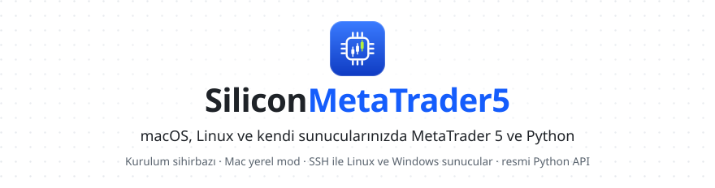
</picture>

<p>
  <a href="#kurulum"><b>Kurulum</b></a> &nbsp;·&nbsp;
  <a href="#uygulama-turu"><b>Tur</b></a> &nbsp;·&nbsp;
  <a href="#python-hızlı-başlangıç"><b>Python</b></a> &nbsp;·&nbsp;
  <a href="#smt5-komut-satırı"><b>CLI</b></a> &nbsp;·&nbsp;
  <a href="README.md"><b>English</b></a>
</p>

<a href="https://github.com/bahadirumutiscimen/silicon-metatrader5/releases/latest"></a>
<a href="https://pypi.org/project/siliconmetatrader5/"></a>
<a href="https://github.com/bahadirumutiscimen/silicon-metatrader5/releases"></a>
<a href="https://pypistats.org/packages/siliconmetatrader5"></a>


<a href="#lisans"></a>

<br><br>

<picture>
  <source media="(prefers-color-scheme: dark)" srcset="docs/images/tr/overview-dark.webp">
  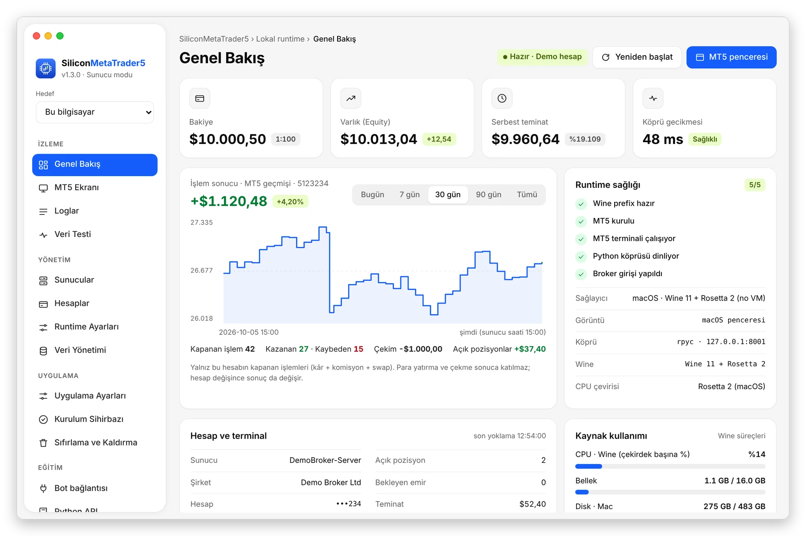
</picture>

**Genel Bakış.** Bakiye, varlık, işlem sonucu ve runtime durumu tek yerde.

</div>

SiliconMetaTrader5, gerçek bir **MetaTrader 5** terminalini küçük bir Python köprüsüyle birlikte çalıştırır. Böylece MetaQuotes'un resmi [`MetaTrader5`](https://www.mql5.com/en/docs/python_metatrader5) paketi için yazılmış kod bir **Mac**'te, **Linux**'ta ya da size ait bir **Linux veya Windows sunucuda** çalışır. Kodunuzda yalnızca bir satır değişir.

> [!CAUTION]
> Gerçek parayla işlemden önce stratejinizi demo hesapta deneyin.

## Kısaca

| | SiliconMetaTrader5 |
| :-- | :-- |
| **Nedir** | Windows dışındaki Python kodu için MetaTrader 5'i (MT5) çalıştıran bir masaüstü uygulaması, runtime ve Python paketi |
| **Python API** | MetaQuotes'un resmi `MetaTrader5` paketiyle aynı fonksiyonlar: `copy_rates_from_pos`, `symbol_info_tick`, `order_send`, `positions_get`, … |
| **Nerede çalışır** | Apple Silicon (M1, M2, M3, M4) ve Intel macOS · Linux x86_64 · SSH ile kendi Linux veya Windows VPS'iniz |
| **Kimin için** | MT5 piyasa verisi ve emirleri kullanan algoritmik işlem, trading botları, backtest, araştırma defterleri ve veri akışları |
| **Kurulum** | `brew tap bahadirumutiscimen/siliconmt5 https://github.com/bahadirumutiscimen/silicon-metatrader5 && brew trust bahadirumutiscimen/siliconmt5 && brew install siliconmt5` · `.deb` / `.AppImage` · `pip install siliconmetatrader5` |

## Öne çıkanlar

<table>
<tr>
<td width="33%" valign="top"><br><b>Kurulum sihirbazı</b><br>Makineyi kontrol eder, eksikleri onayınızla kurar ve gerçek verinin geldiğini test eder.</td>
<td width="33%" valign="top"><br><b>Mac yerel mod</b><br>MT5, Rosetta 2 altında Wine 11'de. VM yok, Docker yok: v1.2'ye göre 30 kata kadar hızlı.</td>
<td width="33%" valign="top"><br><b>Kendi sunucularınız</b><br>SSH ile Linux veya Windows VPS. Bilgisayarınız kapalıyken de işlem yapmaya devam eder.</td>
</tr>
<tr>
<td valign="top"><br><b>Uygulama içinde MT5 ekranı</b><br>Brokerınıza girin, grafikleri kullanın. ⌘C / ⌘V MT5'e Ctrl olarak gider, pano eşitlenir.</td>
<td valign="top"><br><b>Bot bağlantı rehberi</b><br>Botunuz nerede çalışırsa çalışsın doğru host ve portu, 3 satırlık bir testle gösterir.</td>
<td valign="top"><br><b>Veri ve hız testleri</b><br>Barlar, tickler ve broker saati, kodunuzun kullandığı yoldan kontrol edilir.</td>
</tr>
<tr>
<td valign="top"><br><b>Veri yönetimi</b><br>Broker, sembol ve yıla göre geçmiş ve tick depolama, güvenli temizlikle.</td>
<td valign="top"><br><b><code>smt5</code> komut satırı</b><br>Uygulamanın yaptığı her şey terminalden ya da betikten. Her komutta <code>--json</code> var.</td>
<td valign="top"><br><b>Gizliliğe göre tasarlandı</b><br>Portlar yalnızca 127.0.0.1'de dinler. Uygulama şifrelerinizi okumaz, saklamaz.</td>
</tr>
</table>

## 1.3 ile daha hızlı

Yeni **Mac yerel mod** MT5'i sanal makine olmadan doğrudan macOS'ta çalıştırır. Aynı Mac, v1.2 ve v1.3:

<p align="center">
<picture>
  <source media="(prefers-color-scheme: dark)" srcset="docs/images/speed-tr-dark.svg">
  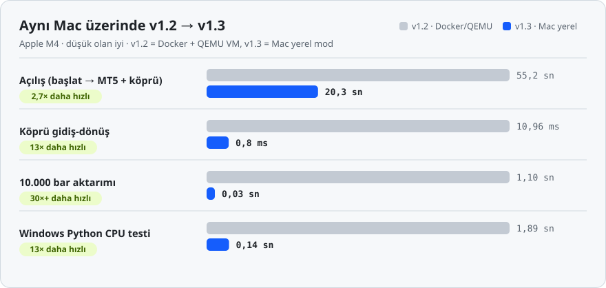
</picture>
</p>

Aynı testi kendi makinenizde **Veri Testi** sayfasından ya da `smt5 bench` ile çalıştırabilirsiniz.

## Parçalar nasıl birleşiyor

<p align="center">
<picture>
  <source media="(prefers-color-scheme: dark)" srcset="docs/images/arch-tr-dark.svg">
  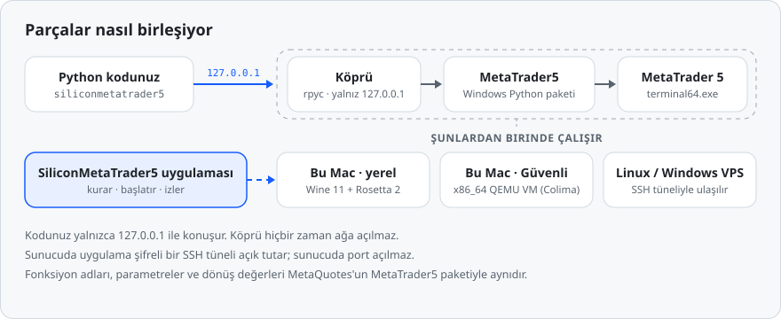
</picture>
</p>

### MT5 nerede çalışabilir

| | Mod | MT5 nasıl çalışır | Ne için uygun |
| :-- | :-- | :-- | :-- |
|  **macOS** | **Mac yerel** (önerilen) | Doğrudan macOS'ta, normal bir pencere olarak | Geliştirme, backtest, Mac açıkken çalışan botlar |
|  **macOS** | **Güvenli** (yedek) | Yalıtılmış bir sanal makinede | Rosetta 2 olmayan Mac'ler |
|  **Linux x86_64** | **Linux yerel** veya **Docker** | Doğrudan, ekranlı ya da ekransız | Linux masaüstleri ve PC'ler |
|  **Linux sunucu** | Linux yerel veya Docker | Uygulama SSH ile kurar ve yönetir | 7/24 botlar |
|  **Windows sunucu** | Windows | Doğrudan; uygulama SSH ile yönetir | 7/24 botlar |

### Windows dışında MT5'i Python'dan kullanmanın diğer yolları

| | Windows sanal makinesi | Elle kurulan Wine | **SiliconMetaTrader5** |
| :-- | :-- | :-- | :-- |
| Kurulum | VM içine Windows, MT5 ve Python kurulur | Wine, Windows Python, MT5 ve köprüyü kendiniz kurarsınız | Tek sihirbaz, her adım kontrol edilir |
| Python kodunuz | VM içinde çalışır ya da ayrı bir ağ köprüsü ister | Bakımını sizin yaptığınız bir köprü ister | Kendi makinenizde çalışır; tek satırla 127.0.0.1'e bağlanır |
| Apple Silicon | ARM için Windows, MT5'i kendi emülasyonuyla çalıştırır | Wine derlemesine bağlı | Wine 11 + Rosetta 2, yukarıda ölçüldü |
| Sunucular | Her VPS için ayrı kurulum | Her VPS için ayrı kurulum | Aynı uygulamadan, SSH ile Linux ve Windows VPS |
| İzleme | Yerleşik değil | Yerleşik değil | Sağlık, loglar, veri ve hız testleri, menü çubuğu paneli |

## Kurulum

**macOS**

```bash
brew tap bahadirumutiscimen/siliconmt5 https://github.com/bahadirumutiscimen/silicon-metatrader5
brew trust bahadirumutiscimen/siliconmt5
brew install siliconmt5
smt5 app-install          # uygulamayı Uygulamalar'a ekler
```

**Linux x86_64**: [Releases](https://github.com/bahadirumutiscimen/silicon-metatrader5/releases/latest) sayfasından `.deb` ya da `.AppImage`.

**Python**

```bash
pip install siliconmetatrader5
```

<details>
<summary><b>Kaynaktan derleme</b></summary>

```bash
git clone https://github.com/bahadirumutiscimen/silicon-metatrader5.git
cd silicon-metatrader5/app
cargo build --release -p smt5-cli -p smt5-desktop   # uygulama: target/release/siliconmt5 · CLI: target/release/smt5
export PATH="$PWD/target/release:$PATH"
```

Linux derleme gereksinimleri: [`app/README.md`](app/README.md).
</details>

## Uygulama turu

### Kurulum sihirbazı

<p align="center">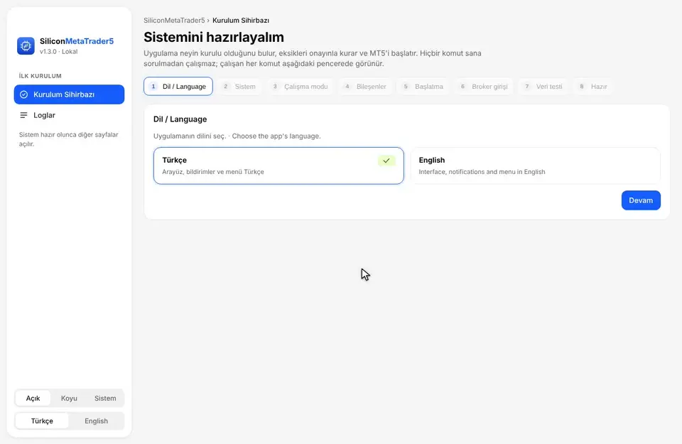</p>

**Boş bir Mac'ten çalışan MT5'e.** Dili, sistemi ve modu seçin. Sihirbaz eksikleri onayınızla kurar, MT5'i başlatır ve veriyi kontrol eder.

### MT5 ekranı

<table>
<tr>
<td width="50%" valign="top">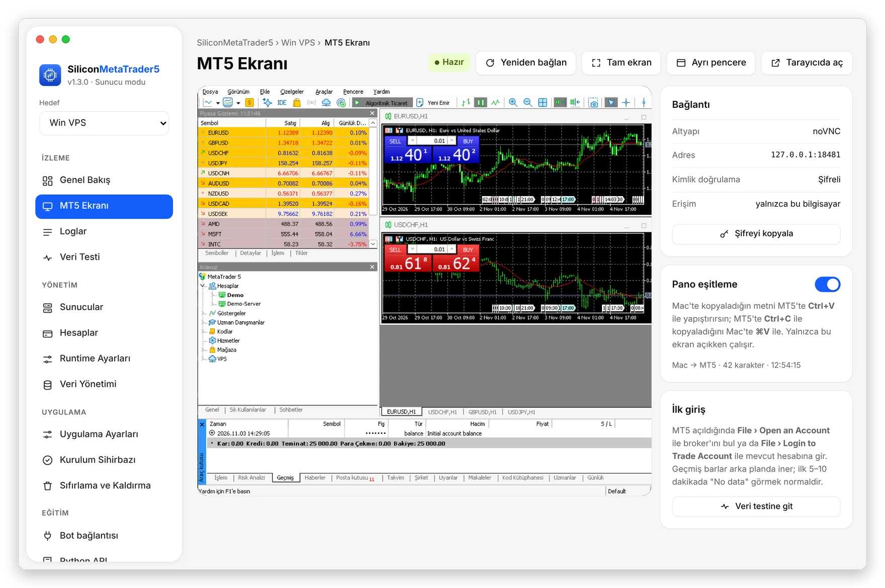</td>
<td width="50%" valign="top">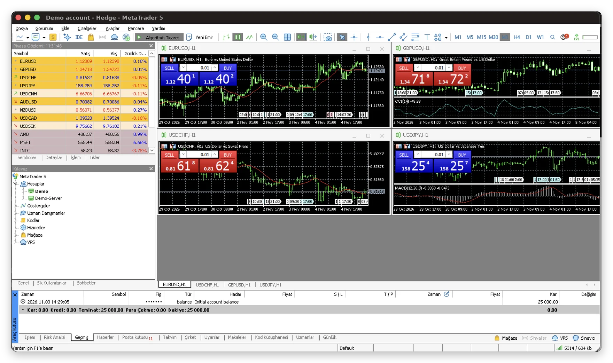</td>
</tr>
<tr>
<td valign="top"><b>Uygulamanın içinde</b>: sunucular ve Linux için. ⌘C / ⌘V her Mac uygulamasındaki gibi çalışır, pano iki yönde eşitlenir.</td>
<td valign="top"><b>Normal bir macOS penceresi</b>: Mac yerel modda.</td>
</tr>
</table>

### Sunucular

<p align="center">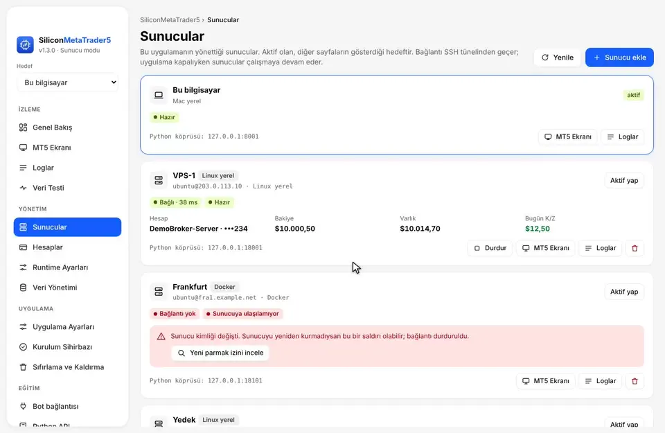</p>

**Tek formla sunucu ekleyin.** Linux ya da Windows'u seçip SSH adresini yazın. Ön kontrol neyin eksik olduğunu ve nasıl düzeltileceğini gösterir.

<p align="center">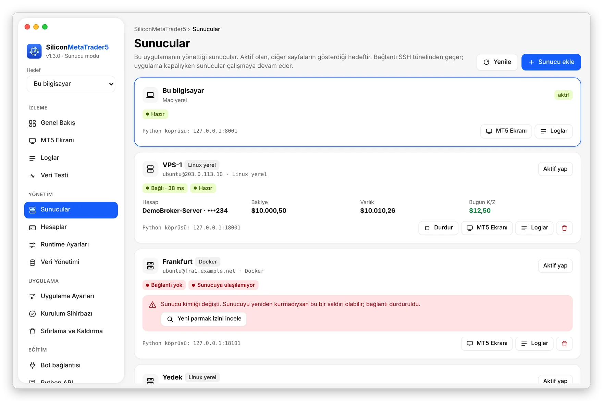</p>

**Her sunucu bir kart**: bağlantı, hesap, bakiye ve bugünkü sonuç. Uygulama kapalıyken sunucular çalışmaya devam eder.

<details>
<summary><b>Linux sunucu gereksinimleri</b></summary>

* Ubuntu veya Debian, x86_64, 2 GB RAM, 3 GB boş disk.
* Eksik paketleri ön kontrol, kurulum komutuyla birlikte listeler.
</details>

<details>
<summary><b>Windows sunucu gereksinimleri</b></summary>

* Windows 10 1809+ ya da Windows Server 2019+, x64, yönetici hesabı.
* OpenSSH Server bir kez açılır; komutu sihirbaz gösterir.
* MT5 açık bir masaüstü ister; kurulum otomatik oturum açmayı etkinleştirir ve bir kez yeniden başlatır. Şifreyi sunucuda siz yazarsınız; uygulama görmez.
* Kaldır yalnızca uygulamanın kurduklarını siler.
</details>

### Bot bağlantısı

<p align="center">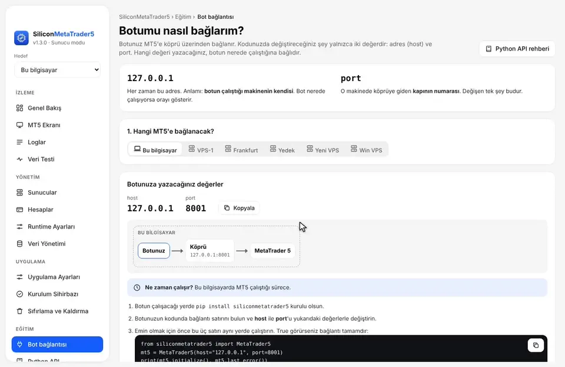</p>

**Botum hangi adresi kullanmalı?** MT5'i ve botun nerede çalışacağını seçin; sayfa kurulumunuza göre host ve portu gösterir.

| Botunuz nerede | Host | Port | Ne zaman çalışır |
| :-- | :-- | :-- | :-- |
| Bu bilgisayarda, MT5 bu bilgisayarda | `127.0.0.1` | yerel köprü portu (8001) | MT5 çalıştıkça |
| Bu bilgisayarda, MT5 sunucuda | `127.0.0.1` | sunucunun tünel portu (ör. 18001) | uygulama açıkken |
| Sunucunun kendisinde | `127.0.0.1` | sunucunun kendi köprü portu (8001) | her zaman, bilgisayarınız kapalıyken de |
| Başka bir bilgisayarda | `127.0.0.1` | `ssh -N -L 18001:127.0.0.1:8001 kullanıcı@sunucu` sonrası 18001 | o komut açık kaldıkça |

Köprü yalnızca 127.0.0.1'de dinler; sunucunun IP'si yerine bu değerleri kullanın.

### Veri testi ve hız testi

<p align="center">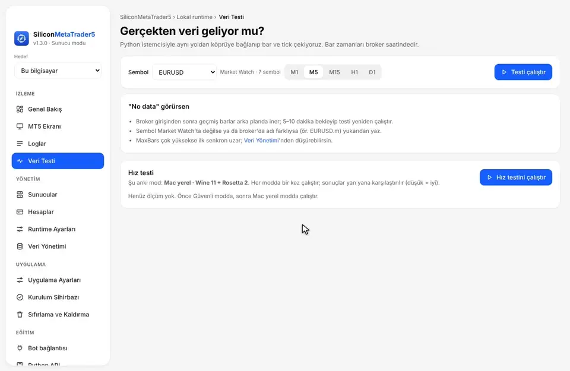</p>

**Gerçekten veri geliyor mu?** Kodunuzun kullandığı köprüden sekiz kontrol, son barlar çizilerek. Hız testi modları karşılaştırır.

### Veri, hesaplar ve loglar

<table>
<tr>
<td width="50%" valign="top">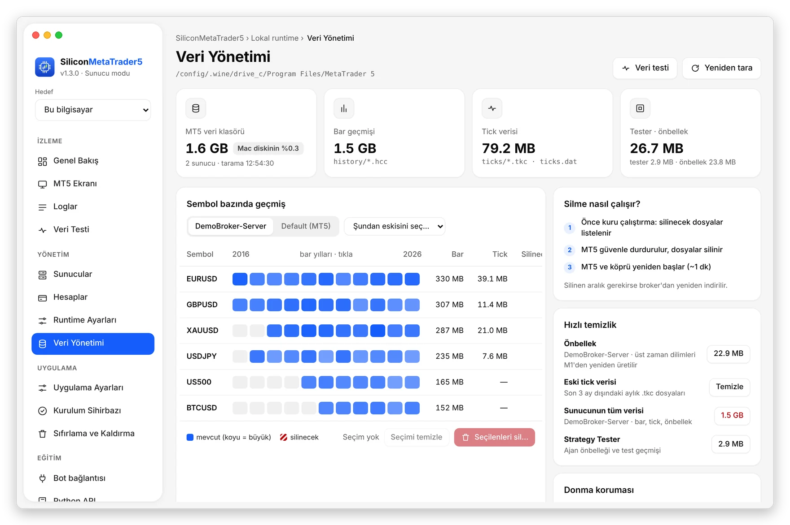<br><b>Veri Yönetimi.</b> Broker, sembol ve yıla göre geçmiş ve tickler, güvenli temizlikle.</td>
<td width="50%" valign="top">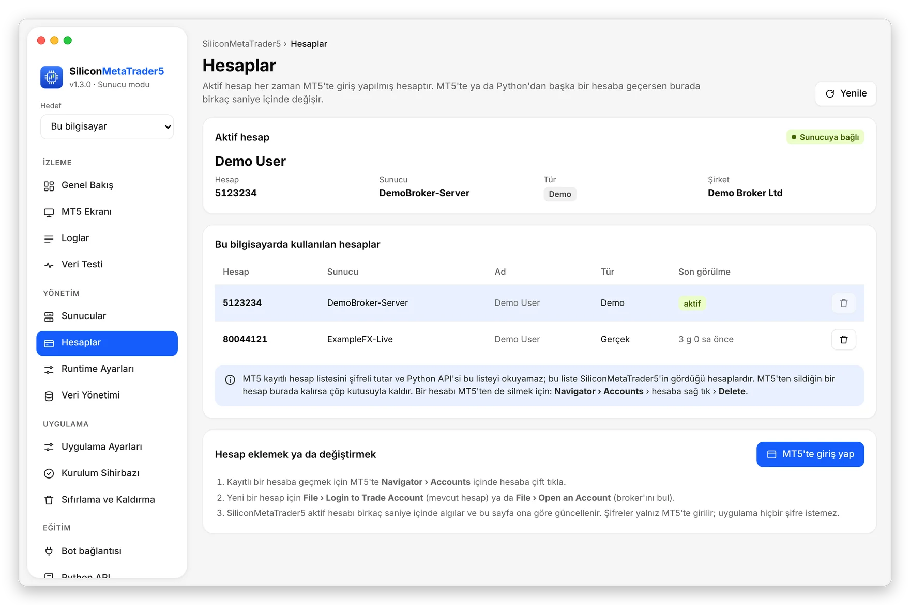<br><b>Hesaplar.</b> Aktif hesap ve bu bilgisayarda kullanılan hesaplar.</td>
</tr>
<tr>
<td valign="top">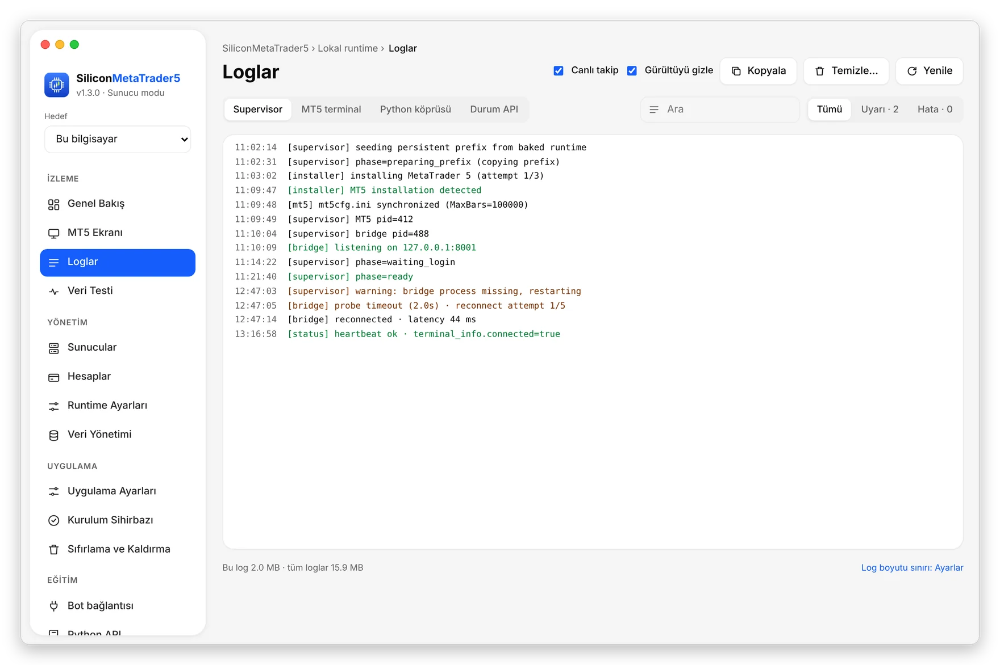<br><b>Loglar.</b> Arama ve gürültü filtresiyle canlı loglar.</td>
<td valign="top">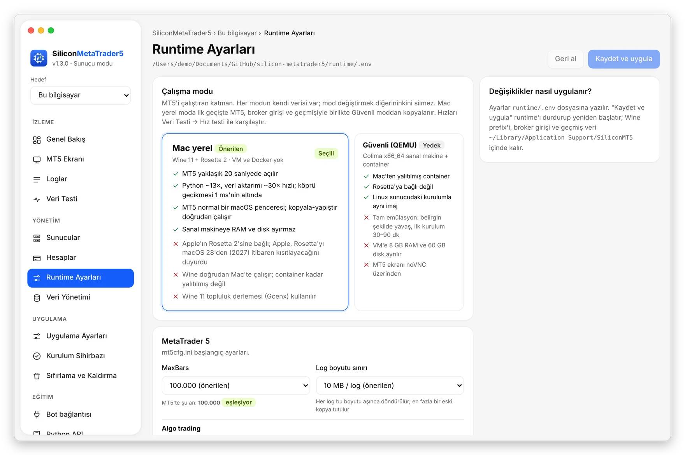<br><b>Runtime Ayarları.</b> Mod, MaxBars, Algo Trading, ekran ve portlar.</td>
</tr>
<tr>
<td valign="top">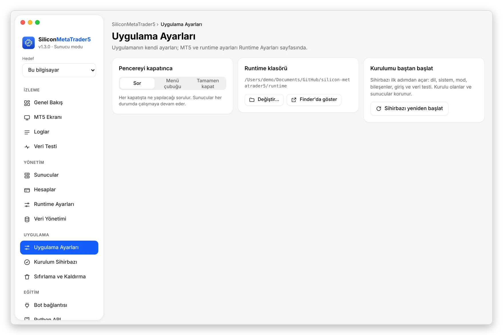<br><b>Uygulama Ayarları.</b> Pencere davranışı ve kurulum.</td>
<td valign="top">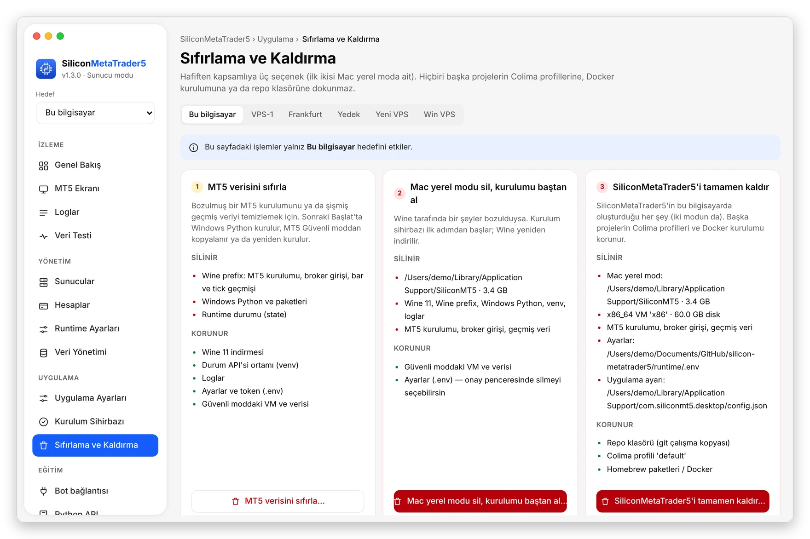<br><b>Sıfırlama ve Kaldırma.</b> MT5 verisini sıfırlayın ya da her şeyi kaldırın; neyin silineceği açıkça listelenir.</td>
</tr>
</table>

### Menü çubuğu, Python rehberi ve örnek strateji

<table>
<tr>
<td width="28%" valign="top">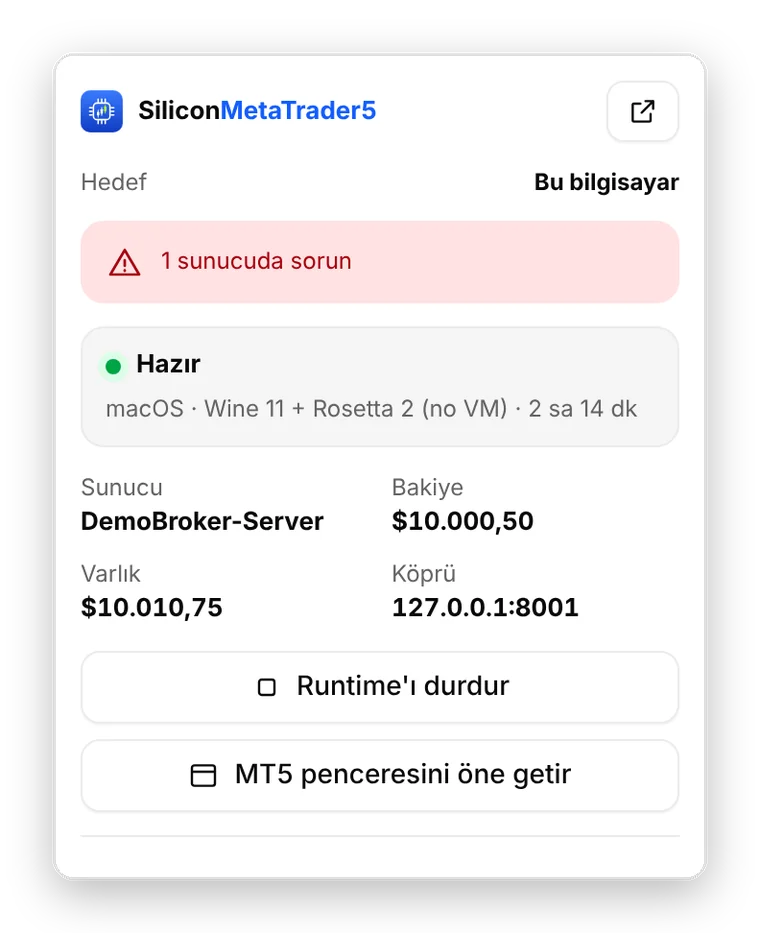<br><b>Menü çubuğu paneli.</b> Durum ve bakiye bir bakışta.</td>
<td width="36%" valign="top">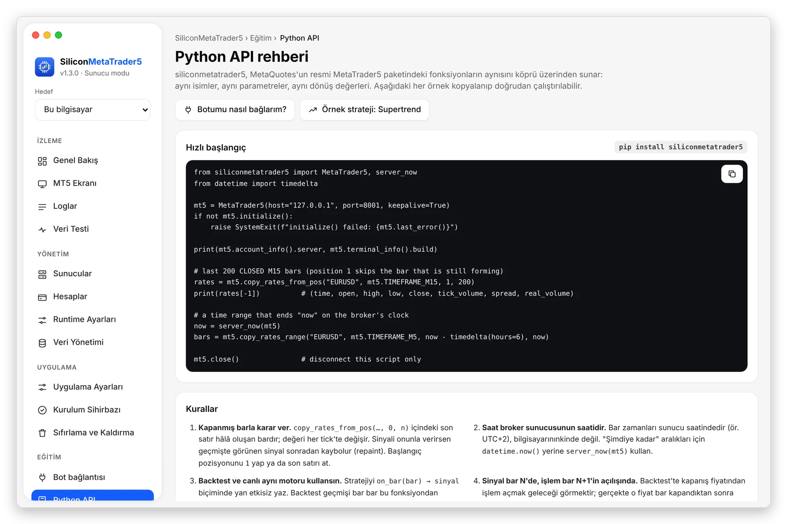<br><b>Python API rehberi.</b> Her fonksiyon kopyalanabilir bir örnekle.</td>
<td width="36%" valign="top">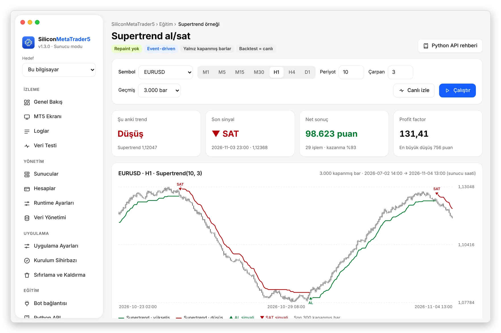<br><b>Supertrend örneği.</b> Backtest ve canlı sinyal için aynı kod.</td>
</tr>
</table>

## Python hızlı başlangıç

MT5'te brokerınıza giriş yaptıktan sonra:

```python
import pandas as pd
from datetime import timedelta
from siliconmetatrader5 import MetaTrader5, server_now

mt5 = MetaTrader5(host="127.0.0.1", port=8001, keepalive=True)   # port için "Bot bağlantısı" sayfasına bakın
if not mt5.initialize():
    raise SystemExit(f"initialize() başarısız: {mt5.last_error()}")

print(mt5.account_info().server, mt5.terminal_info().build)

# kapanmış son 200 M15 bar (1. pozisyon hâlâ oluşan barı atlar)
rates = mt5.copy_rates_from_pos("EURUSD", mt5.TIMEFRAME_M15, 1, 200)
print(pd.DataFrame(rates).tail())

# broker saatine göre "şimdi"de biten bir aralık
now = server_now(mt5)
bars = mt5.copy_rates_range("EURUSD", mt5.TIMEFRAME_M5, now - timedelta(hours=6), now)

mt5.close()   # yalnızca bu betiğin bağlantısını keser; shutdown() köprünün tüm istemcilerini keser
```

Resmi paketle yazılmış bir botta yalnızca bağlantı satırları değişir:

```python
# önce                                 # sonra
import MetaTrader5 as mt5              from siliconmetatrader5 import MetaTrader5
mt5.initialize()                       mt5 = MetaTrader5(host="127.0.0.1", port=8001)
                                       mt5.initialize()
```

Bar zamanları broker'ın saatindedir; `datetime.now()` yerine `server_now(mt5)` kullanın. Daha fazlası [istemci README'sinde](client/README.md).

## `smt5` komut satırı

<details>
<summary><b>Komut listesi</b></summary>

| Komut | Ne yapar |
| :-- | :-- |
| `smt5 doctor` | Gereksinimleri ve sağlığı kontrol eder, her sorun için tam çözümü verir |
| `smt5 init` | Rastgele bir API token'ıyla ayarları oluşturur |
| `smt5 mode [safe\|native]` | Modu gösterir ya da değiştirir (çalışan önce durdurulur) |
| `smt5 build` / `pull` | Yerel runtime'ı kurar ya da Docker imajını derler / çeker |
| `smt5 up` / `down` / `restart [mt5\|bridge]` | Başlat, durdur, yeniden başlat |
| `smt5 status` / `watch` / `logs <kaynak>` | Faz, canlı faz, loglar |
| `smt5 test EURUSD --tf M5` | Köprü üzerinden veri testi |
| `smt5 bench` | Hız testi: açılış, CPU, copy_rates, aktarım, gecikme |
| `smt5 symbols` | Market Watch sembolleri |
| `smt5 data` / `purge …` | Geçmiş envanteri ve güvenli silme |
| `smt5 mt5-import` | MT5'i (giriş ve geçmiş) Güvenli moddan yerel moda kopyalar |
| `smt5 vm start\|stop\|status` | Güvenli modun Colima VM'i |
| `smt5 app-install` | macOS Homebrew: uygulamayı Uygulamalar'a kopyalar |

Bütün komutlar `--json` kabul eder.
</details>

## Güvenlik ve gizlilik

* Her port 127.0.0.1'de dinler; sunuculara şifreli bir SSH tüneliyle ulaşılır.
* Uygulama şifrelerinizi okumaz, saklamaz.
* Kimliği değişen bir sunucu, siz onaylayana kadar engellenir.

## SSS

<details><summary><b>Apple Silicon (M1, M2, M3, M4) bir Mac'te MetaTrader5 Python paketini nasıl kullanırım?</b></summary>

SiliconMetaTrader5'i ve `pip install siliconmetatrader5` ile istemciyi kurun; `import MetaTrader5 as mt5` yerine `mt5 = MetaTrader5(host="127.0.0.1", port=8001)` yazın. Kodunuzun geri kalanı aynı kalır.
</details>

<details><summary><b>MetaTrader 5 Python API Linux'ta çalışır mı?</b></summary>

Evet, Linux x86_64'te, ekranlı ya da ekransız.
</details>

<details><summary><b>Bir MT5 trading botunu VPS'te 7/24 nasıl çalıştırırım?</b></summary>

Sunucuyu uygulamaya ekleyin, botunuzu oraya kopyalayın ve orada `127.0.0.1:8001`'e bağlayın. Bilgisayarınız kapalıyken de çalışır.
</details>

<details><summary><b>Emir gönderebilir miyim, yoksa yalnızca okuma mı?</b></summary>

Resmi paketin yapabildiği her şey çalışır: `order_send` ve `positions_get` dahil.
</details>

<details><summary><b>Mac'imi yeniden başlattım. Şimdi ne yapmalıyım?</b></summary>

Uygulamayı açıp **Başlat**'a basın. Sunucular kendi başına çalışmaya devam eder.
</details>

<details><summary><b>v1.2'deki (Güvenli mod) MT5 verimi kullanmaya devam edebilir miyim?</b></summary>

Evet. Mac yerel mod giriş bilgilerinizi ve geçmişi oradan kopyalar.
</details>

<details><summary><b>Veri testi "Veri yok" diyor.</b></summary>

Geçmiş ilk girişten sonra iner; birkaç dakika bekleyin. Sembolün Market Watch'ta ve brokerınızın yazdığı gibi olduğundan emin olun (ör. `EURUSD.m`).
</details>

## Depo

| Klasör | Ne var |
| :-- | :-- |
| [`app/`](app) | Masaüstü uygulaması (Tauri v2) ve `smt5` komut satırı, Rust ile |
| [`runtime/`](runtime) | MT5 runtime'ı: macOS ve Linux yerel betikleri, Docker imajı, Windows sunucu betikleri, durum API'si |
| [`client/`](client) | Python paketi [`siliconmetatrader5`](https://pypi.org/project/siliconmetatrader5/) |
| [`examples/`](examples) | Küçük betikler: veri çekme, bar çizme |
| [`packaging/`](packaging) | Homebrew formülü ve Linux test betikleri |

## Lisans

[PolyForm Noncommercial 1.0.0](LICENSE): kişisel ve ticari olmayan kullanım serbesttir. Ticari kullanım için geliştiriciden lisans almanız gerekir; bunun için bir issue açın. Üçüncü taraf bileşenler için [NOTICE](NOTICE).

## Destek

Bu proje size zaman kazandırıyorsa TRC20 ağında USDT ile destek olabilirsiniz:

```text
TMh8eS5EPRL77Z7L4KhsKmccSNLgf6Rfta
```

<p align="center"><sub>MetaTrader 5 · MT5 · MetaTrader5 Python API · MQL5 · macOS · Apple Silicon M1 M2 M3 M4 · Linux · Wine · Rosetta 2 · Windows VPS · Linux VPS · algoritmik işlem · trading botu · forex · CFD · backtest · RPyC köprüsü</sub></p>

<p align="center"><sub>© 2025–2026 Bahadır Umut İşçimen · PolyForm Noncommercial 1.0.0 · MetaTrader, MetaQuotes Ltd.'nin ticari markasıdır; bu proje MetaQuotes ile bağlantılı değildir.</sub></p>
