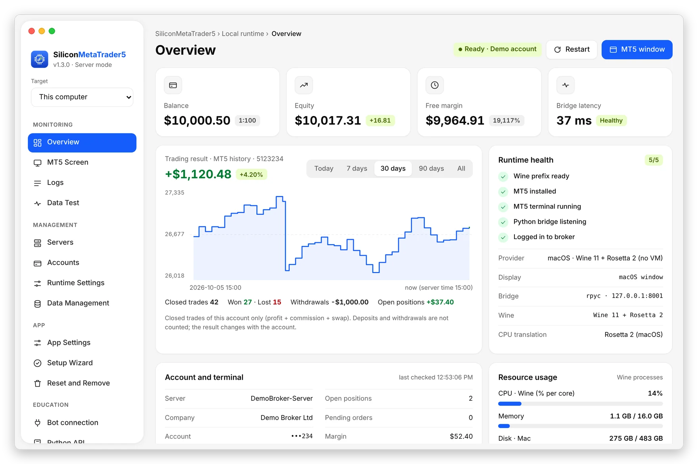
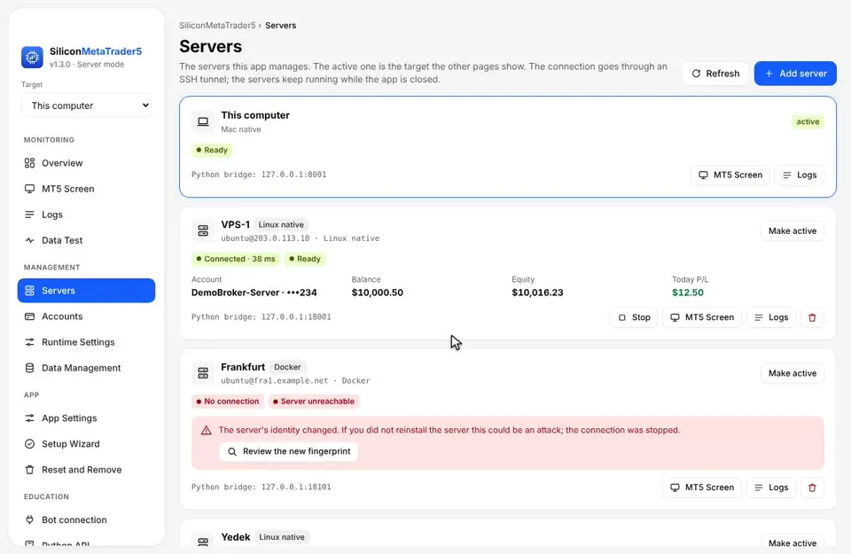

<p align="center"></p>

## SiliconMetaTrader5 1.3: MT5 for Python, now with a desktop app, a native Mac mode and your own servers

The biggest release so far. 1.2 was a Docker image and a Python client. **1.3 is a full desktop app**: it installs MetaTrader 5, keeps it running and shows you everything, on your Mac, on Linux, or on a Linux or Windows VPS you own. Your Python code still changes only one line.

### Up to 30× faster on a Mac

The new **Mac native mode** runs MT5 directly on macOS under Rosetta 2. No virtual machine, no Docker. Measured on the same Apple M4:

| | 1.2 (Docker + QEMU) | 1.3 (Mac native) | |
| :-- | --: | --: | :-- |
| Startup | 55.2 s | 20.3 s | **2.7× faster** |
| Bridge round trip | 10.96 ms | 0.8 ms | **13× faster** |
| 10,000 bars | 1.10 s | 0.03 s | **30×+ faster** |
| Windows Python CPU | 1.89 s | 0.14 s | **13× faster** |

### What's new

- 🪄 **Setup wizard**: checks your machine, installs what is missing with your approval, starts MT5 and tests that real data arrives.
- 🖥 **Servers**: add a Linux or Windows VPS over SSH and run your bots 24/7, even with your computer off. Every server is a card with its account, balance and today's result.
- 📺 **MT5 screen inside the app**: log in to your broker and use your charts. ⌘C / ⌘V work as on any Mac app, and the clipboard syncs both ways.
- 🔌 **Bot connection guide**: shows the exact host and port for wherever your bot runs, with a 3-line test.
- 📈 **Data and speed tests**: eight checks through the same bridge your code uses, and a side-by-side speed test.
- 🗂 **Data management, accounts, logs, settings** and a **menu bar panel**.
- 🐧 **Linux native mode**: MT5 without Docker on Linux x86_64, with or without a display.
- 🐍 **Python client 1.3.0**: `server_now()` and other broker-clock helpers, Python 3.14 support.
- ⌨️ **`smt5` command line**: everything the app does, from a terminal or script, with `--json`.
- 🔒 **Private by design**: every port listens on 127.0.0.1, servers are reached over an encrypted SSH tunnel, and the app never reads or stores your passwords.

<p align="center"></p>

### Install

```bash
# macOS
brew install bahadirumutiscimen/tap/siliconmt5 && smt5 app-install

# Python
pip install --upgrade siliconmetatrader5
```

Linux: download the `.deb` or `.AppImage` below.

### Upgrading from 1.2

- The `docker/` and `docker_kasm/` folders are replaced by `runtime/` and the app. The new runtime uses its own volumes: log in to your broker once more after the first start.
- **License:** SiliconMetaTrader5 is now licensed under the [PolyForm Noncommercial License 1.0.0](https://polyformproject.org/licenses/noncommercial/1.0.0). Personal and other noncommercial use is free; commercial use needs a license from the author.

Full overview, screenshots and FAQ: [README](https://github.com/bahadirumutiscimen/silicon-metatrader5#readme) · [Türkçe](https://github.com/bahadirumutiscimen/silicon-metatrader5/blob/main/README_TR.md)
